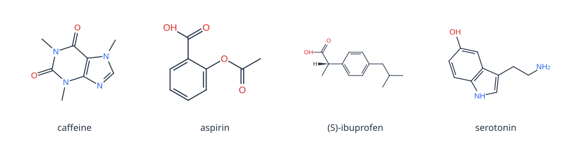
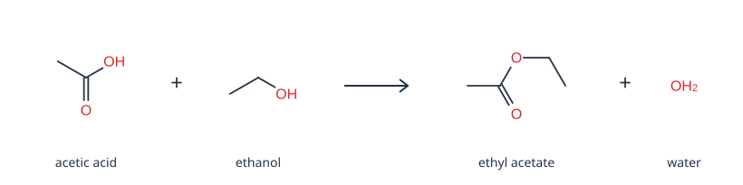
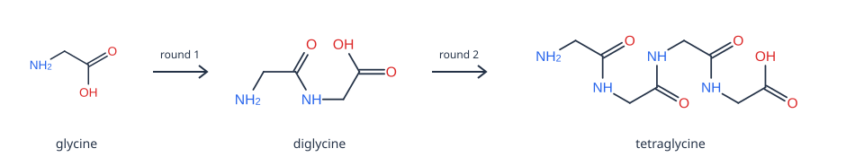

<p align="center">
  <picture>
    <source media="(prefers-color-scheme: dark)" srcset="assets/logo-dark.svg">
    
  </picture>
</p>

# oxidane

oxidane is a cheminformatics library written in Rust, with Python bindings.
You can use it to read SMILES, SMARTS and SDF files, write canonical SMILES,
deal with tautomers and stereochemistry, search for substructures, run
reactions, compute fingerprints and descriptors, and generate 3D conformers.

It is written entirely in Rust and has no C or C++ dependencies. The name is
the IUPAC name for water.

<p align="center">
  
</p>

## Installation

### Rust

oxidane is not on crates.io yet, so add it as a git dependency:

```toml
[dependencies]
oxidane = { git = "https://github.com/um-univie/oxidane" }
```

The neural-network code is behind the `ml` feature. You only need it if you
want to train or run models; parsing, descriptors and featurization work
without it.

### Python

```sh
uv pip install "oxidane @ git+https://github.com/um-univie/oxidane#subdirectory=bindings/python"
```

This compiles the extension, so you need a Rust toolchain. Prebuilt wheels for
Linux, macOS and Windows are produced by the "Build the Python wheels" workflow
under Actions.

The main functions work on a single SMILES or on a whole column:

```python
import oxidane as ox

df["canonical_smiles"] = ox.canonical_smiles(df["smiles"])
df["tautomer_key"] = ox.tautomer_key(df["smiles"])
df["parent"] = ox.parent_compound(df["smiles"])
```

There is also a command-line tool, `oxidane-normalize`, that adds these
columns to a CSV, TSV or SMILES file. See the
[Python README](bindings/python/README.md) for everything else, including
molecule objects, SMARTS, reactions and drawing molecules in Jupyter.

## A first example

```rust
use oxidane::prelude::*;

// Parse. A SMILES can hold several disconnected molecules, so you get a Vec.
let aspirin = MolecularGraph::from_smiles_single("CC(=O)Oc1ccccc1C(=O)O").unwrap();

assert_eq!(aspirin.molecular_formula().to_string(), "C9H8O4");

// Substructure search. This is a carboxylic acid.
assert!(matches_cxsmarts(&aspirin, "[CX3](=O)[OX2H1]").unwrap());

// Two writings of the same molecule canonicalise to one string.
use oxidane::graph_algorithms::mol_canonization::canonicalize_and_sort_smiles;

assert_eq!(
    canonicalize_and_sort_smiles("CC(=O)Oc1ccccc1C(=O)O", false).unwrap(),
    canonicalize_and_sort_smiles("O=C(C)Oc1ccccc1C(O)=O", false).unwrap(),
);
```

## Features

- **File formats:** SMILES, SDF and MOL (V2000), XYZ, GML and DOT, plus SVG
  output for quick pictures. Stereo wedges in 2D molfiles are turned into
  stereocentres.
- **Perception:** aromaticity, implicit hydrogens, rings and all stereo classes
  in the SMILES spec. R/S and E/Z labels come from a port of RDKit's
  CIPLabeler.
- **Canonical SMILES**, including stereochemistry.
- **Tautomers:** a key that is the same for all tautomers of a compound (so
  2-pyridone and 2-hydroxypyridine match), and a canonical tautomer.
- **Parent compounds** for mass spectrometry libraries: salts and counterions
  removed, sodium drawn as a bond split off, and protons adjusted to give the
  neutral molecule.
- **Substructure search** with CxSMARTS, including recursive SMARTS and
  chirality.
- **Maximum common substructure**, using either a clique search or McSplit.
- **Reactions** from reaction SMARTS or MØD's GML rules, applied to single
  molecules or to sets of them.
- **Fingerprints:** Morgan/ECFP, atom pairs, topological torsions, MACCS keys,
  MHFP and MAP4.
- **Descriptors:** Crippen logP and molar refractivity, TPSA, H-bond donors and
  acceptors, rotatable bonds, Bemis-Murcko scaffolds, and shape descriptors
  (USR, USRCAT) for 3D structures.
- **3D conformers** with an ETKDG-style distance geometry embedder.
- **Force fields:** MMFF94 and UFF, with energies, gradients and minimisation.
- **Machine learning:** atom and bond features, scaffold splits and batching for
  graph neural networks, and an optional encoder built on `candle`.

## Molecules with and without coordinates

`MolecularGraph` is a molecule without coordinates, which is what you get from
SMILES. `Molecule3D` is the same thing with atom positions, for example from an
XYZ file, a 3D SDF or the embedder. Most functionality is written as traits, so
it works the same on both.

```rust
use oxidane::prelude::*;
use oxidane::molecule::descriptors::MolecularDescriptors;

let caffeine =
    MolecularGraph::from_smiles_single("Cn1cnc2c1c(=O)n(C)c(=O)n2C").unwrap();

assert_eq!(caffeine.molecular_formula().to_string(), "C8H10N4O2");
assert!((caffeine.molecular_weight() - 194.19).abs() < 0.01);
```

## Reading an SDF file

```rust
use oxidane::prelude::*;
use oxidane::io::SdfParseOptions;

// Hydrogens, stereochemistry and aromaticity are all perceived by default.
let molecules = Molecule3D::from_sdf("tests/pentene.sdf").unwrap();
assert_eq!(molecules.len(), 1);

// Or ask for exactly the atoms the file listed, and nothing else.
let literal = Molecule3D::from_sdf_with(
    "tests/pentene.sdf",
    SdfParseOptions { hydrogens: false, stereochemistry: false, aromaticity: None },
).unwrap();
assert!(literal[0].atomic_numbers().len() <= molecules[0].atomic_numbers().len());
```

## Substructures and reactions

<p align="center">
  
</p>

```rust
use oxidane::prelude::*;
use oxidane::molecule::reaction::ReactionSmarts;

let ester = MolecularGraph::from_smiles_single("CC(=O)OCC").unwrap();

// Every match, as atom indices into the molecule.
let matches = find_cxsmarts_matches(&ester, "[CX3](=O)[OX2][CX4]").unwrap();
assert_eq!(matches.len(), 1);

// Hydrolysis, written as a mapped transformation.
let hydrolysis =
    ReactionSmarts::parse("[C:1](=[O:2])[O:3][C:4]>>[C:1](=[O:2])[O:3].[C:4]")
        .unwrap();
let products = hydrolysis.apply(&ester);
assert!(!products.is_empty());
```

## Generating molecules with rules

Reactions can also be used to grow a set of molecules. Here two rules, ester
and amide formation, are applied to every pair of molecules for two rounds,
starting from acetic acid, ethanol and glycine. Among the products are the
glycine peptides:

<p align="center">
  
</p>

```rust
use std::collections::BTreeSet;
use oxidane::prelude::*;
use oxidane::graph_algorithms::mol_canonization::canonicalize_and_sort_smiles;
use oxidane::molecule::reaction::ReactionSmarts;

let canonical = |smiles: &str| canonicalize_and_sort_smiles(smiles, false).unwrap();
let rules = [
    // carboxylic acid + alcohol -> ester + water
    "[C:1](=[O:2])[OX2H1:3].[OX2H1:4][CX4:5]>>[C:1](=[O:2])[O:4][C:5].[O:3]",
    // carboxylic acid + amine -> amide + water
    "[C:1](=[O:2])[OX2H1:3].[NX3H2:4][CX4:5]>>[C:1](=[O:2])[N:4][C:5].[O:3]",
]
.map(|rule| ReactionSmarts::parse(rule).unwrap());

let mut molecules: BTreeSet<String> =
    ["CC(=O)O", "CCO", "NCC(=O)O"].into_iter().map(canonical).collect();

for _ in 0..2 {
    let current: Vec<MolecularGraph> = molecules
        .iter()
        .map(|smiles| MolecularGraph::from_smiles_single(smiles).unwrap())
        .collect();
    for rule in &rules {
        for first in &current {
            for second in &current {
                for product in rule.apply_to(&[first, second]) {
                    let written = canonical(&product.to_smiles());
                    molecules.extend(written.split('.').map(String::from));
                }
            }
        }
    }
}

// 3 starting molecules, 5 new ones after the first round and 8 after the
// second, among them the glycine peptides up to tetraglycine.
assert_eq!(molecules.len(), 16);
assert!(molecules.contains(&canonical("NCC(=O)NCC(=O)NCC(=O)NCC(=O)O")));
assert!(molecules.contains(&canonical("CCOC(=O)C")));
```

## 3D structures

```rust
use oxidane::prelude::*;

let molecule = MolecularGraph::from_smiles_single("C[C@H](N)C(=O)O").unwrap();
let embedded = molecule.embed_3d().unwrap();

// Coordinates for every atom, with the stereocentre the SMILES asked for.
assert_eq!(embedded.positions.len(), embedded.atomic_numbers().len());

// Score or relax a structure with MMFF94, or UFF where MMFF94 has no types.
use oxidane::molecule::forcefield::Field;

let field = Field::best_for(&embedded).unwrap();
let mut positions = embedded.positions.clone();
let energy = field.minimize(&mut positions, 500);
assert_eq!(field.name(), "MMFF94");
assert!(energy <= field.energy(&embedded.positions) + 1e-9);
```

## Related projects

[`chemistry_consts`](https://crates.io/crates/chemistry_consts) contains the
periodic table data oxidane uses: masses, isotopes, radii, valences and
electronegativities.

## Pictures

All the pictures here are drawn by oxidane itself. The molecule, reaction and
peptide figures come from `cargo run --example readme_figures`, which applies
the same rules as the example above.

The logo is a water molecule, drawn with the H-O-H angle that oxidane's own
embedder gives. You can regenerate it with `cargo run --example logo`.

## License

MIT
